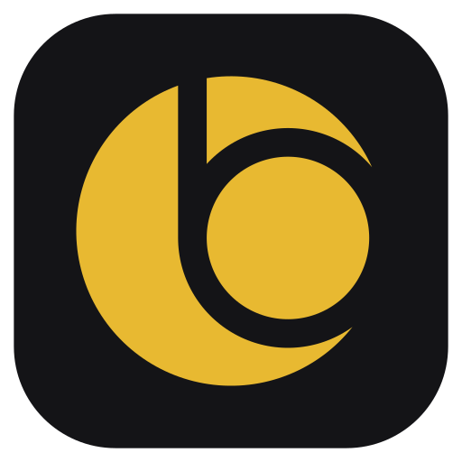

# Contributing to bemotion

Thanks for your interest! Code is one way to help, and so are bug reports,
plugins, presets, translations and spreading the word. If you would rather
support the work directly, you can [buy a coffee](https://buymeacoffee.com/eugeniobenfica). It keeps bemotion
free for everyone.

bemotion aims to stay **simple, fast and easy to maintain**, so a few
guidelines:

1. **Read [docs/ARCHITECTURE.md](docs/ARCHITECTURE.md) first.** It explains the
   layers, the rules, how to add properties, effects, operations and panels,
   and how to work alongside others (including AI agents) without conflicts.
2. **Style:** C++20, 4-space indentation, 120 columns. A `.clang-format` file
   is provided — run `clang-format -i` on the files you touch.
   Types are `PascalCase`, functions and variables `camelCase`, private
   members end with `_`, constants start with `k`.
3. **Tests:** add or update tests in `tests/` for changes to `src/core`, and
   make sure `ctest --test-dir build` passes.
4. **File format:** never break existing `.bemotion` files. Add new properties
   with sensible defaults; bump `Project::kFormatVersion` only for
   incompatible changes and keep loading older versions.
5. **Commits / PRs:** one change per commit — a fix, a feature, a refactor —
   never several at once ("Masks, scopes and proxies" is three commits), so
   each can be reviewed, bisected and reverted alone. A short imperative
   subject (72 characters at most, no period), a blank line, then what
   changed and why. Docs and tests go in the same commit as the code. CI
   checks the messages of a pull request (`tools/check-commits.py
   origin/main..HEAD` runs the same check locally). Screenshots are welcome
   for UI changes (the pull request template has a checklist).
6. **Issues:** use the *Bug report* or *Feature request* forms; a small
   `.bemotion` project that shows a problem helps a lot.

## Building

See [Getting started](README.md#getting-started) in the README: Qt 6, FFmpeg and
Skia — `tools/skia/fetch-skia.sh` downloads the one CI built (minutes), and
`tools/skia/build-skia.sh` builds it (about an hour) when there is none for
your system (on Windows, from an MSYS2 UCRT64 shell). Keep the clone outside
synced folders (OneDrive, Dropbox): they lock files while the build writes
them.

## Checking a change

```bash
cmake --build build && ctest --test-dir build   # core tests, fuzzing (5 s), golden images, languages
tools/smoke-test.sh build smoke                  # exports, automation, MCP, the app offscreen
python3 tools/bench.py build                     # startup, a frame, an export
```

The builds have presets (`CMakePresets.json`): `dev` (`build/`, the one
above), `release` (`build-release/`, what `tools/build-release.sh` packages),
`sanitize` (`build-sanitize/`, address and undefined behavior sanitizers, as
the CI) and `coverage` (`build-coverage/`: `tools/coverage.sh` builds it, runs
the tests and writes which lines they reached).

- A change to the drawing that is meant: `python3 tools/golden.py build/bemotion --update`
  (`bemotion.exe` on Windows), and look at the new images before committing them.
- A crash or a hang the fuzzer (`build/bemotion_fuzz`) found is written out
  with the `--seed` / `--at` that replays it (see `tests/fuzz.cpp`).
- Interface changes: run the app with a scratch `BEMOTION_APPDATA` and a
  `BEMOTION_SCRIPT` (see [docs/ARCHITECTURE.md §13](docs/ARCHITECTURE.md#13-testing-and-verification))
  and look at the captures. Never test with your real settings.
- Official plugins (`assets/plugins`) are not in the packages: after changing
  one, run `python3 tools/plugin-index.py` so the catalog lists the new files.

## Where to start

Issues labelled *good first issue* are small and self-contained. Translations
are a good first step too: `python3 tools/languages.py --missing pt-BR` lists
what a language lacks (copy `assets/languages/pt-BR.json` to start a new one).
