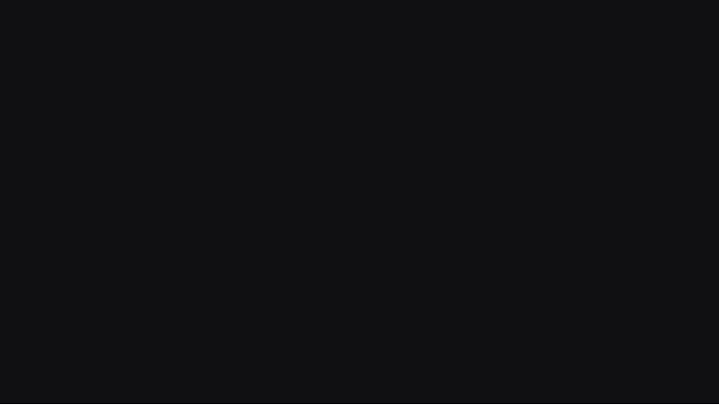
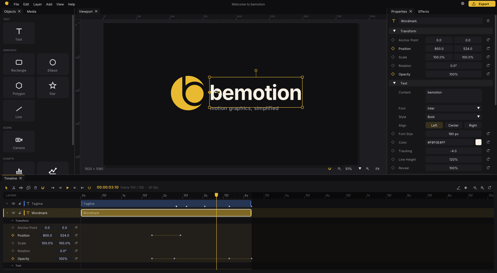

<div align="center">


# bemotion

**Motion graphics, simplified.**<br>
A minimal, open source 2D motion graphics animator — fast, focused and free.

[](https://github.com/eugeniobenfica/bemotion/actions/workflows/build.yml)
[](LICENSE)




<sub>The intro above is an ordinary bemotion project, built from four shapes and two texts —<br>
open <b>Welcome to bemotion</b> from the home screen and take it apart.</sub>

[Features](#features) · [Getting started](#getting-started) · [Shortcuts](#keyboard-shortcuts) · [Plugins](docs/PLUGINS.md) · [Contributing](CONTRIBUTING.md)

</div>

---

bemotion gives you a clean, focused space to animate text, graphics and footage:
drop an object on the canvas, set keyframes, pick an easing and press play.
Everything is customizable — color, transform, stroke, typography, timing — while
the most common moves are one click away through *Quick Animations*. It follows
the conventions of After Effects and Premiere, so it feels familiar from the
first minute.

> 🇧🇷 **Resumo:** bemotion é um animador 2D minimalista e de código aberto para
> motion graphics. Escrito em C++20 com Qt, Skia e FFmpeg, com foco em
> simplicidade, liberdade de customização e uma interface limpa no modo escuro.

<p align="center">
  
</p>

## Features

<table>
<tr>
<td width="50%" valign="top">

### ✦ Create
- **Objects**: text, rectangle, ellipse, polygon, star, line, camera and plugin
  objects — click to add, or drag onto the canvas or the timeline
- **Media**: import images, video and audio (Ctrl+I or drop files on the
  window) into the *Media* panel; media layers animate like everything else
  and get an animatable *Volume*
- **Compounds** (Ctrl+G): group layers into one object with its own timeline
- **Edit text in place**: double-click a text on the canvas

</td>
<td width="50%" valign="top">

### ✦ Animate
- Every property keyframable, with a reset button and live values
- **Graph Editor**, motion paths with bezier handles, easing presets and a
  custom cubic-bezier curve editor; Easy Ease with F9
- **Quick Animations**: Fade, Pop, Slide, Drop, Spin, Pulse, Typewriter,
  Draw On… stackable, importable, savable
- **Effects**: blur, color, distort, glow, drop shadow, motion blur… GPU
  rendered, stackable, keyframable, with presets

</td>
</tr>
<tr>
<td valign="top">

### ✦ Edit
- **Timeline** with multi-clip tracks, trimming, cut tool (C), split at
  playhead (Ctrl+K), snapping to clips, keys and the playhead
- **Your own toolbar**: drag tools and actions from the *Tools* panel into
  the timeline's toolbar, reorder them, drag them out to remove
- **No fixed length**: the composition ends where its last clip ends and grows
  as you add objects or extend clips
- **Viewport** with box selection, rulers, guides and smart snapping
- **Camera** with position, rotation and zoom

</td>
<td valign="top">

### ✦ Deliver
- **Export** to MP4 / H.264 (built in on Windows), PNG sequences with
  transparency, and with [FFmpeg](https://ffmpeg.org) MOV ProRes 4444, WebM VP9
  and GIF
- Audio is mixed in: AAC in MP4, PCM in MOV, Opus in WebM, a `.wav` beside PNGs
- Render from the command line for automation

</td>
</tr>
<tr>
<td valign="top">

### ✦ Make it yours
- Dark, Light and Midnight themes, any accent color, an advanced mode for
  every UI color; import / export themes ([example](examples/themes))
- Rebind every shortcut, pick the interface font and text size, timeline
  densities, frames per arrow press
- Dockable panels: drag tabs anywhere, float them, pin one to auto-hide on the
  window edge, double-click a tab to maximize it

</td>
<td valign="top">

### ✦ Extend
- **Plugins** are sandboxed Lua scripts that add new kinds of objects
- The bundled **Charts** plugin draws animated column / bar, line / area and
  donut charts from a data table you can paste from a spreadsheet
- Plugin **commands** edit the project (the bundled *Layout* plugin
  distributes, staggers and fades layers) — see [docs/PLUGINS.md](docs/PLUGINS.md)
- **Robot-friendly**: scripts and AI assistants create and edit projects from
  the command line — `describe`, `apply` [operations](docs/OPERATIONS.md),
  Lua `script`s, `render` contact sheets to look at, `validate` — every change
  checked, atomic and undoable — and `bemotion mcp` plugs it straight into
  Claude and other MCP assistants ([docs/AUTOMATION.md](docs/AUTOMATION.md))

</td>
</tr>
</table>

<details>
<summary><b>All the details</b></summary>

- **Home screen** with recent projects (live thumbnails), search, the Welcome
  project, a *⋯* menu on each card (show in folder, remove from the list,
  delete to the Recycle Bin / Trash) and a *New Project* dialog with format
  presets (Full HD, 4K, Vertical/Reels, Square…)
- **Media panel** (like After Effects' *Project* panel): images (PNG, JPEG,
  BMP, TGA, GIF, PSD, HDR), audio (WAV, MP3, FLAC, M4A/AAC, OGG/Opus, WMA, AIFF)
  and video (MP4, MOV, M4V, MKV, WebM, AVI, WMV, MPEG, MTS) on every platform,
  through FFmpeg.
  Audio plays with the timeline, clips show their waveform, video and audio
  clips trim only within their source, and missing files can be relinked
- **Viewport**: wheel zoom around the cursor, pan with middle/right drag,
  Space+drag or Alt+drag; corner handles scale (Shift = uniform), the rotation
  handle rotates (Shift = 15° snaps)
- **Snapping** (S): canvas center and edges, other layers, rulers and custom
  guides; hold Ctrl while dragging to skip it
- **Properties panel**: collapsible sections, any installed font family, a
  *Source* section for media layers (Fit to Composition, Show in Folder)
- **Effects tab** (like *Effect Controls* + *Effects & Presets*): Gaussian and
  Directional Blur, Brightness & Contrast, Hue/Saturation, Tint, Invert, Wave
  Warp, Fill, Stroke, Drop Shadow, Glow and Motion Blur
- **Compounds**: move, scale, rotate, fade and take effects as a whole;
  double-click to open their timeline (a breadcrumb leads back); Ctrl+Shift+G
  releases the layers keeping their look
- **New objects** start at the playhead and last 5 seconds (like Premiere's
  default still duration); the playhead may go past the end to add more
- **Settings** (Ctrl+,): Theme, Interface, Editor, Shortcuts and Plugins pages,
  each with a reset; the intro animation can be turned off in *Interface*
- **Help** (F1): every shortcut drawn as key caps, plus About, Credits and License
- **Undo / redo** for everything, unsaved-changes protection

</details>

## Download (Windows)

Grab `bemotion-<version>-setup.exe` from the latest successful
[build](https://github.com/eugeniobenfica/bemotion/actions/workflows/build.yml)
(*Artifacts › bemotion-windows*), or build it yourself (below).

- **Installer**: installs for your user only (no administrator rights), adds a
  Start Menu shortcut (desktop shortcut optional), opens `.bemotion` files with a
  double-click and can be removed from *Settings › Apps*. Your settings and
  projects stay when you uninstall.
- **Portable zip**: unzip anywhere (even a USB stick) and run `bemotion.exe`.

Runs on 64-bit Windows 10 (1809 or later) and Windows 11, on any x86-64 CPU —
optimized code paths for newer processors are picked at runtime. The files are
not signed yet, so SmartScreen may warn on first launch (*More info › Run anyway*).
If something goes wrong, `%APPDATA%emotionemotion.log` says what happened.

### Building the installer yourself

With MSYS2 set up as in *Getting started* (below) and Skia built once,
double-click **`build-release.bat`** — or, in an MSYS2 UCRT64 shell:

```bash
tools/build-release.sh
```

It builds a Release in `build-release/`, runs the tests, packages and checks the
package; the installer and the portable zip land in `dist/`.

## Getting started

bemotion is built with CMake and needs a few system libraries — **Qt 6** (≥ 6.4),
**FFmpeg** (libavformat, libavcodec, libavfilter, libswscale, libswresample),
HarfBuzz, ICU and the usual image libraries — plus **Skia**, which
`tools/skia/build-skia.sh` builds once from a pinned revision into
`third_party/skia` (it takes a while). The rest (Qt Advanced Docking System,
nlohmann/json, stb, Lua, miniaudio) is fetched on the first configure.

**Windows** — in an [MSYS2](https://www.msys2.org) **UCRT64** shell:

```bash
pacman -S --needed git patch mingw-w64-ucrt-x86_64-{toolchain,cmake,ninja,pkgconf,python,gn}   mingw-w64-ucrt-x86_64-{qt6-base,qt6-svg,qt6-tools,ffmpeg,harfbuzz,icu,libjpeg-turbo,libwebp,libpng,expat,zlib,freetype}
tools/skia/build-skia.sh
cmake -S . -B build -G Ninja -DCMAKE_BUILD_TYPE=Release
cmake --build build
./build/bemotion.exe
tools/package-windows.sh build dist           # installer + portable zip (needs: pacman -S mingw-w64-ucrt-x86_64-nsis)
```

**Linux** (Ubuntu 24.04):

```bash
sudo apt install ninja-build clang python3 pkg-config qt6-base-dev qt6-base-private-dev qt6-base-dev-tools qt6-qpa-plugins libqt6svg6-dev libgl-dev libxkbcommon-dev   libavcodec-dev libavformat-dev libavfilter-dev libswscale-dev libswresample-dev libavutil-dev   libharfbuzz-dev libicu-dev libfreetype-dev libfontconfig-dev libpng-dev libjpeg-dev libwebp-dev libexpat1-dev zlib1g-dev
tools/skia/build-skia.sh
cmake -S . -B build -G Ninja -DCMAKE_BUILD_TYPE=Release && cmake --build build
./build/bemotion
```

**macOS** (Homebrew):

```bash
brew install ninja pkgconf qt ffmpeg harfbuzz icu4c freetype fontconfig libpng jpeg-turbo webp
export PKG_CONFIG_PATH="$(brew --prefix icu4c)/lib/pkgconfig:$(brew --prefix jpeg-turbo)/lib/pkgconfig"
tools/skia/build-skia.sh
cmake -S . -B build -G Ninja -DCMAKE_BUILD_TYPE=Release -DCMAKE_PREFIX_PATH="$(brew --prefix qt)"
cmake --build build && ./build/bemotion
```

Run the unit tests with `ctest --test-dir build`. A Skia built elsewhere can be
used with `-DSKIA_ROOT=<dir>`.

### Rendering from the command line

```bash
bemotion assets/welcome/Welcome.bemotion --export welcome.mp4
bemotion project.bemotion --export frames/shot.png --transparent --scale 0.5
```

The format follows the file extension (`.mp4`, `.png`, `.mov`, `.webm`, `.gif`).

## Keyboard shortcuts

Every shortcut can be changed in *Settings › Shortcuts*; *Help* (F1) shows the
current ones.

<details>
<summary><b>Default shortcuts</b></summary>

| Keys | Action |
| --- | --- |
| <kbd>Space</kbd> | Play / pause (hold + drag: pan the viewport) |
| <kbd>←</kbd> / <kbd>→</kbd> (Shift: ×10) | Previous / next frame |
| <kbd>Home</kbd> / <kbd>End</kbd> | Go to start / end |
| <kbd>J</kbd> / <kbd>K</kbd> | Previous / next keyframe |
| <kbd>V</kbd> / <kbd>C</kbd> | Selection tool / Cut tool |
| <kbd>Ctrl</kbd>+<kbd>K</kbd> | Split selected layers at the playhead |
| <kbd>T</kbd> | Add text (double-click a text to edit it) |
| <kbd>Ctrl</kbd>+<kbd>A</kbd> | Select all layers |
| <kbd>Ctrl</kbd>+<kbd>]</kbd> / <kbd>Ctrl</kbd>+<kbd>[</kbd> (Shift: to front / back) | Bring forward / send backward |
| <kbd>Ctrl</kbd>+<kbd>Z</kbd> / <kbd>Ctrl</kbd>+<kbd>Shift</kbd>+<kbd>Z</kbd> | Undo / redo |
| <kbd>Ctrl</kbd>+<kbd>D</kbd> | Duplicate layers |
| <kbd>Ctrl</kbd>+<kbd>G</kbd> / <kbd>Ctrl</kbd>+<kbd>Shift</kbd>+<kbd>G</kbd> | Create / release a compound |
| <kbd>Delete</kbd> | Delete selected keyframes, or the layers |
| <kbd>Ctrl</kbd>+<kbd>S</kbd> / <kbd>Ctrl</kbd>+<kbd>Shift</kbd>+<kbd>S</kbd> | Save / save as |
| <kbd>Ctrl</kbd>+<kbd>I</kbd> | Import media |
| <kbd>Ctrl</kbd>+<kbd>M</kbd> | Export video |
| <kbd>S</kbd> | Toggle snapping (hold Ctrl while dragging to skip it) |
| <kbd>Ctrl</kbd>+<kbd>,</kbd> | Settings |
| <kbd>F9</kbd> / <kbd>Shift</kbd>+<kbd>F9</kbd> / <kbd>Ctrl</kbd>+<kbd>Shift</kbd>+<kbd>F9</kbd> | Easy Ease / Ease In / Ease Out on the selected keyframes |
| Wheel · Middle/right drag | Zoom · pan the viewport |
| <kbd>Ctrl</kbd>+<kbd>0</kbd> / <kbd>Ctrl</kbd>+<kbd>1</kbd> / <kbd>Ctrl</kbd>+<kbd>=</kbd> / <kbd>Ctrl</kbd>+<kbd>-</kbd> | Fit / 100% / zoom in / zoom out |

</details>

## Project layout

```
src/core     document model (layers, keyframes, easing, file format, undo) — no UI code
src/render   draws compositions with Skia (viewport, thumbnails, export), text shaping, the logo mark
src/export   video / image-sequence encoders and the export job
src/media    imported media: image / audio / video decoding (FFmpeg), audio playback and mixing
src/ui       Qt interface: theme, widgets, intro, home screen, editor window, dock panels, dialogs
src/app      application window, OS integration, settings, preset/theme libraries, plugin host
assets       fonts, bundled plugins, the Welcome project and the brand files
tools        Skia build script and the Windows deploy script
tests        unit tests for the core
```

See [docs/ARCHITECTURE.md](docs/ARCHITECTURE.md) for how the pieces fit
together and [CONTRIBUTING.md](CONTRIBUTING.md) to get involved.

## Brand

The mark is a disc with a lowercase **b** cut out of it, in the accent gold
(`#E8B931`) on the interface's near-black (`#141417`). Its geometry lives in
[`src/render/LogoMark.h`](src/render/LogoMark.h) and every brand file is drawn
from it — regenerate them with `bemotion --write-icon <file.ico|png|svg>` and
`bemotion --write-mark <file.svg>`.

| | File |
| --- | --- |
| App icon | [`assets/branding/icon.svg`](assets/branding/icon.svg) · [`.ico`](assets/branding/bemotion.ico) · [`1024 px .png`](assets/branding/icon-1024.png) |
| Mark only | [`assets/branding/mark.svg`](assets/branding/mark.svg) |
| Intro / Welcome project | [`assets/welcome/Welcome.bemotion`](assets/welcome/Welcome.bemotion) |
| Social preview | [`docs/media/social-preview.png`](docs/media/social-preview.png) |

## License

bemotion is released under the [MIT License](LICENSE). The bundled Inter font is
licensed under the [SIL Open Font License](assets/fonts/Inter-OFL.txt).

<div align="center">
<sub>Made with care — and animated with bemotion.</sub>
</div>
