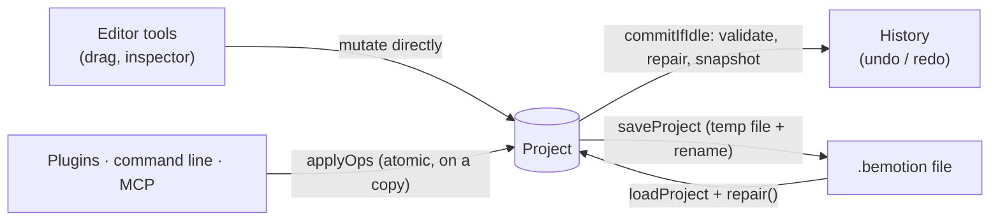
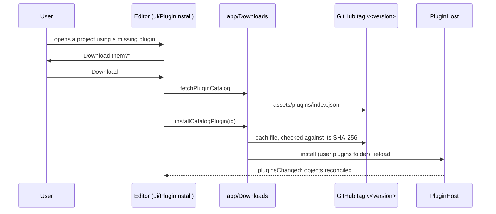

# Architecture and conventions

This is the reference for anyone changing bemotion — people and AI agents
alike. It says how the program is organized, which rules the code follows and
how to add things the way the rest of the code does, so that changes made by
different contributors (or several agents at once) fit together without
conflicts. When code and this document disagree, fix one of them in the same
change.

Contents: [1. Principles](#1-principles) ·
[2. Layers and dependencies](#2-layers-and-dependencies) ·
[3. The document model](#3-the-document-model-srccore) ·
[4. Changing a project](#4-changing-a-project-the-three-paths) ·
[5. Rendering](#5-rendering-srcrender) · [6. Media and export](#6-media-and-export) ·
[7. The editor](#7-the-editor-srcui) · [8. The application](#8-the-application-srcapp) ·
[9. Plugins](#9-plugins) · [10. Automation and AI](#10-automation-and-ai) ·
[11. Code conventions](#11-code-conventions) · [12. Recipes](#12-recipes-adding-things) ·
[13. Testing and verification](#13-testing-and-verification) ·
[14. Build, packaging, CI](#14-build-packaging-ci) ·
[15. Working in parallel](#15-working-in-parallel-humans-and-agents)

---

## 1. Principles

bemotion is a video editor (in the spirit of Premiere) with 2D animation at its
heart, free, calm rather than a cockpit, human and robot friendly, fast, and a
small core extended by plugins — see "The idea" in the [README](../README.md).
It is an idea more than a technology: the philosophy, the file format, the
operations and this document define it, so any part can be replaced or
rewritten without changing what bemotion is. The engineering principles that
follow from that:

1. **The core is the truth.** The document model (`src/core`) is plain C++20
   with no UI, graphics or OS code. Everything else is a view of it or a way
   to change it.
2. **One rule book.** What makes a project valid is written once, in
   `core/Validate`. Every way of changing a project ends in a valid project.
3. **One door from outside.** Plugins, the command line and AI tools change
   projects only through operations (`core/Ops`): validated, atomic, versioned.
   A new ability for scripts is added there, once, for all of them.
4. **What you see is what you export.** The viewport, thumbnails and export use
   the same renderer (`render/SceneRenderer`), on the CPU, deterministically:
   the same project and time give the same pixels.
5. **Never lose the user's work.** Old files keep opening, saves are atomic,
   damaged files are repaired instead of refused, undo covers everything.
6. **Industry conventions.** When in doubt, do what After Effects / Premiere
   users expect (names, shortcuts, units, behaviors).
7. **Simple and durable over clever.** Snapshot undo instead of inverse
   commands, plain structs, few dependencies with long lives (Qt, Skia,
   FFmpeg, Lua).
8. **Replaceable parts.** Libraries stay behind small seams (`Platform`,
   `ui::Draw`, the renderer, the encoders, `OpEnvironment`) and contracts are
   written down (file format, operations, plugin API), so a part can be
   rewritten — in another library or language — without touching the rest.
9. **A small core, the rest switchable.** The download stays essential; new
   kinds of objects, commands and workflows go into plugins when they can.
   What needs native speed (speech to text, tracking, bending, scopes, SVG and
   Lottie) stays in the app as built-in features that can be turned off like
   plugins (`ui/Modules`).
10. **Calm interface.** Show what is needed now; everything else one click away
   and rearrangeable. No feature earns permanent space by default.

## 2. Layers and dependencies

```
src/app      application, command line, MCP server, plugins, settings, OS (Qt)
 └─ src/ui       Qt Widgets editor: window, panels, dialogs
     ├─ libs/bestyle the look: theme, widget style, icons, shared controls (Qt only)
     ├─ src/export   export job and encoders (FFmpeg libraries, PNG)
     ├─ src/media    media decoding (FFmpeg, stb), audio playback (miniaudio)
     └─ src/render   draws compositions with Skia (screen and offscreen), text, fonts
         └─ src/core     document model, operations, validation, file format
```

Dependencies only point **down**. In particular:

| Directory | May include | Must not include |
| --- | --- | --- |
| `core` | the C++ standard library, nlohmann/json | Qt, Skia, FFmpeg, Lua, anything above |
| `render` | `core`, Skia | Qt, `ui`, `app` |
| `media`, `export` | `core`, `render`, FFmpeg, stb, miniaudio | Qt, `ui`, `app` (UTF-8 paths: `core/Utf8.h`) |
| `libs/bestyle` | Qt Widgets, nlohmann/json | anything of bemotion (it is reusable by other apps) |
| `ui` | everything below, Qt, `bestyle`, the `app` services (below) | the program: `Application`, `Automation`, `McpServer`, `DevScript`, `AppIcon` |
| `app` | everything | — |

Each layer builds as a static library that links only the ones below it
(`src/CMakeLists.txt`): `bemotion_core`, `bemotion_render`, `bemotion_media`
(`media` and `export`), `bemotion_ui`; the `bemotion` executable adds the
program on top. The build links each layer whole into a program of its own
(`bemotion_layer_render`, `_media`, `_ui`, from `tests/`), so a call into a
layer above is an undefined symbol and the build fails — the rule is checked,
not just written down. A core change must never need Qt to compile. Things a
layer cannot do itself (probe a media file, build a plugin object) come in as
callbacks (`OpEnvironment`).

The application services the editor stands on — `Platform`, `Settings`,
`PluginHost`, `Downloads`, `Recovery`, `ProjectPackage`, `RecentProjects`,
`EffectLibrary`, `PresetLibrary`, `Services` — live in `src/app` but build
into `bemotion_ui`: they use the editor's theme, tools and signals, and the
editor uses them, so they are one layer. What only the program needs (startup,
the command line, MCP, dev scripts) stays in the executable; what the editor
shares with it goes to `app/Services` (`automationEnvironment`,
`renderFramesPng`, `exportProject`).

## 3. The document model (`src/core`)

### Project, composition, layers

- **`Project`** (`Project.h`) — a name and one `Composition`.
- **`Composition`** — size (16–16384 px), frame rate (1–240), background, the
  layer stack, media items, guides. **Index 0 of `layers` is the top-most
  layer.** The duration is derived: `fitDuration()` makes it end with the last
  clip (at least `kMinCompDuration`, 1 s, at most the optional `maxDuration`
  length limit). Never set it as a user value.
- **`Layer`** (`Layer.h`) — id, name, type (`Shape`, `Text`, `Camera`,
  `Plugin`, `Compound`, `Media`), timing (`inPoint` ≤ t < `outPoint`),
  `track`, `parent`, transform, the content of its type, effects. One struct
  holds the props of every type; only the ones of `type` matter.
- **Tracks** — a track is one timeline row. Several layers ("clips") may share
  a track if they do not overlap in time. **Layers of one track are always
  contiguous in `layers`.** Use the composition's track functions
  (`moveTracks`, `shiftTracks`, `moveClipsToTrack`, `moveClipsToNewTracks`,
  `timeShiftLimits`, `splitLayer`, `setInPoint` / `setOutPoint`) instead of
  editing `layers` by hand.
- **Compounds** — a compound groups layers (`Layer::parent`): children draw
  through its transform and their own transform is in its space.
  `createCompound` / `releaseCompound` keep the look when grouping and
  ungrouping; `removeLayerTree` removes a compound with its contents.
- **Backgrounds** — `LayerType::Background` fills the whole frame (color,
  gradient or picture / video): its matrix is the identity, the camera does
  not move it, the viewport does not pick it with a click (only the timeline
  and Properties select it), and new ones go to the bottom of the stack.
- **Media** — `Composition::media` lists imported files (`core/Media.h`); a
  media layer refers to one by id and stores where the source's first frame
  sits in composition time (`MediaProps::start`, moved by `shiftTime`).
  Its crop (`crop_left` … `crop_bottom`, percents of the picture) leaves the
  shown part where it was (`MediaProps::cropRect`, used by drawing and
  bounds); the viewport's Crop tool (`Tool::Crop`) drags it, showing the
  whole picture with the cut-away part dimmed.
- **Cameras** — the top-most active camera frames the scene (`cameraAt`).
  **3D layers** (`Layer::threeD`, top level only) have a Z position
  (`transform.depth`, `position_z`) and X / Y rotation (`rotation_x`,
  `rotation_y`, around their position); the camera has them too (it tilts and
  pans). `viewFor` gives each layer's plane as the camera sees it: a
  `Projective` (3x3) transform whose w is the distance in near-plane units
  (w < 1: too close or behind). `focalLength` is a 50 mm lens on the width;
  facing the camera at its Z it equals the 2D camera, so 2D layers (which
  follow only the camera's pan, roll and zoom) and old projects do not change.
  The renderer draws through the perspective matrix and clips each layer to
  the half-plane in front of the camera; `hitTest` and the viewport's handles
  invert it. A layer's position moves in its unturned plane (`viewFor` with
  `tilted` = false), as does its motion path. `drawOrder` is the stacking
  order with each run of neighboring 3D layers sorted by camera distance,
  farthest first. The free view shows 3D layers as without a camera (the
  default one, `defaultLens`, in perspective). A `Lens` is any point of view (eye position, turn,
  focal length): `lensAt` / `lensOf` give a camera's, `viewThrough` sees a
  layer from one (with `all`, 2D layers too, as planes at Z 0), `project`
  places a 3D point. The renderer sorts by `render::depthOrder`: the far end of
  each layer's box, so a floor is drawn before what stands on it.
- **Viewport 3D** (`ViewportPanel`): the 3D view draws the scene from an
  orbiting `Lens` of its own (`drawComposition(..., lens)`, no frame clip, no
  backgrounds) and overlays the Z 0 frame and each camera (body, frustum to
  what it sees at its Z, the point it looks at). The gizmo's arrows move the
  selected 3D layer (or a camera, in the 3D view) along a world axis, at the
  rate its projection gives; the camera tools (Orbit around the focus point,
  Pan, Dolly) write the camera's position, Z and X / Y rotation at the
  playhead.

### Identity and units

| | |
| --- | --- |
| Layer ids | `uint64_t`, unique, never reused (`Composition::nextLayerId`). The id is the identity; names are for people and may repeat. |
| Track / media ids | same rules (`nextTrackId`, `nextMediaId`). |
| Property ids | stable strings (`"position"`, `"fill_color"`, `"fx0.size"`, `"p.progress"`), used in files and operations. Never rename one; add a new id and migrate. |
| Keyframe uids | `uint32_t` per key, stable while the key exists (selection, drags). |
| Time | `double` seconds from the composition start. Equal within `kTimeEpsilon` (1e-4 s). Frames come from `snapToFrame` / `frameAt`. |
| Space | composition pixels, origin top-left, y down. Rotation in degrees clockwise. Scale, opacity, trims, volume in percent (100 = full). |
| Colors | `Color` floats 0–1, straight (not premultiplied) alpha. |
| Strings | UTF-8 everywhere, including paths (`platform::toUtf8` / `fromUtf8`). |

### Animation

- **`Animated<T>`** (`Animated.h`) — a static `base` value or a sorted list of
  `Keyframe<T>`; `valueAt(t)` interpolates with the easing of the segment's
  first key. `AnimatedBase` is the type-erased interface used by generic code.
- **Easing** (`Easing.h`) — named curves plus `Custom` cubic-beziers; stored by
  id (`easingId`).
- **`Layer::properties()`** lists every animatable property of a layer as a
  `PropertyRef` (id, group, label, kind, UI hints). It is what makes the
  inspector, timeline, file format, operations and validation generic.
  `PropertyRef` holds pointers into the layer: **use it immediately, never
  store it** across edits. Store the layer id + property id instead
  (`findProperty`).
- **Letter animation** (`TextProps::letterIn` / `letterOut` / `letterLoop`,
  by letter, word or line) is drawn by `render/Text.cpp` glyph by glyph
  (`Animator`); the clip's in / out come with `TextClip`. `fitLines` shrinks
  the font in the layout until the wrapped text fits.
- **Counter text** is a text layer with an optional `counter` flag and an animated
  `counter_value` property, which keyframes drive; without keyframes it counts
  by itself from `counter_from` to `counter_to` over `counterDuration` from
  the clip's start (`TextProps::textAt(t, in, out)`), shown by `formatCounter` (decimals, thousands
  separator, prefix and suffix: `text.decimals` / `separator` / `prefix` /
  `suffix` in the file). It uses the regular text renderer and file format;
  older text layers keep their existing behavior.
- `propertyValue` / `setPropertyValue` / `defaultPropertyValue` read and write
  any property as 1, 2 or 4 floats.

### Effects

`Effect` (`Effects.h`) has a type and fixed animatable **slots** (`color`,
`opacity`, `size`, `offset`, `shutter`, `v1`–`v3`); each type uses some of
them (`effectParams`). Slots make effects generic for files, UI and
operations. Effect ids (`effectId`) are stable strings. Two effects carry
more than slots: Apply LUT a `file` (a `.cube` file, `parseCubeLut`; with a
`relative` path saved like media; `bundled:` for `assets/luts`, made by
`tools/make-luts.py`) and Curves four `curves` (RGB, red, green, blue: points
through which `curveValue` draws a monotone cubic). Chroma Key uses slots only.

**Audio effects** (`AudioEffect`: a type and up to three values,
`audioEffectParams` saying which and their ranges) change the sound, never
the picture. Gain and the fades are worked out per sample by the mixer
(`media/AudioEngine`); EQ and Noise Reduction change a clip's samples as a
whole (`core/AudioDsp`: RBJ biquads; a spectral gate over an FFT whose noise
level per frequency is a low percentile of the clip), made once in the
background per (media, `dsp::processKey`) by `MediaManager`, shared by clips
with the same settings and awaited by exports (`audioReady`); Ducking lowers a
clip while another clip with sound is louder than its threshold, from the
other clips' loudness every 10 ms (`dsp::loudness`, made when audio is
decoded), eased over its fade. Reverb (Freeverb), Echo, Compressor, Low / High
Cut and Auto Level (the clip to a target loudness, its passages evened out by a
slow gain rider, a limiter under -1 dBFS) work like EQ: once per clip, in the
background. Silence removal (`dsp::quietStretches` on the loudness, a threshold
set or learned from a sample of the silence) cuts a clip with
`removeQuietParts` (`core/Editing`); `audio.level` and `audio.remove_silence`
are their operations (the sound comes in through `OpEnvironment::mediaLoudness`).

### Rules, files, history

- **`Validate`** — `validate(project)` lists violations, `repair(project)`
  fixes them all (and lists what it fixed). The rules: sizes and frame rate in
  range; unique non-zero ids with counters above them; names not empty; every
  layer on a track; tracks contiguous and without overlaps; in < out by at
  least a frame, in ≥ 0; parents exist, are compounds, no cycles; media layers
  point at existing items; known effect types; keyframes finite, sorted,
  without duplicates. **Adding a rule means adding its check and its repair
  here**, plus a test.
- **`Serialization`** — `.bemotion` is UTF-8 JSON with `"format": "bemotion"`
  and `"version"` (`Project::kFormatVersion`, now 1). Properties are stored by
  id; missing fields take defaults; unknown fields are ignored. Saving writes a
  temporary file and renames it. **Loading repairs** (so nothing above ever
  sees an invalid project). Never break old files: add fields with defaults;
  bump the version only for incompatible changes, keeping a migration.
- **`History`** — undo by snapshots: after each completed edit the serialized
  project is pushed, bounded by steps (200) and by the bytes kept (256 MB; the
  oldest go first, the last step always stays). Each state has a number, so
  "unsaved?" compares numbers, not projects. Editing code does not do undo
  bookkeeping; it changes the project and lets the editor commit (§7).
- **`Describe`** — a compact text summary (for terminals and AIs).
- **`Expressions`** — a formula per property (`AnimatedBase::expression`),
  in a small language of its own (`docs/EXPRESSIONS.md`): parsed once per text
  and cached, run by `Animated<T>::valueAt` (`keyedAt` is the keyframes'
  value, which `value` reads). What it may read is the composition of the
  current `ExpressionScope` (thread-local: rendering opens one, the editor sets
  its own with `setExpressionComposition`); which layer a property belongs to
  is found by address and cached. A failing expression falls back to the
  keyframes and leaves `expressionError`. Saved beside the keys
  (`"expression"`), set with `expression.set`. `expressionNames()` /
  `expressionFunctions()` are the language's one word list (the check, the
  editor's colors and completion, a test against `docs/EXPRESSIONS.md`);
  `evaluateExpressionFor` tries a formula on a property without setting it
  (`query.expression`, `doc.expression`, MCP `test_expression`), and
  `expression.bake` turns one into keyframes. `applyOps` opens a scope on its
  working copy, so values in queries and scripts are what renders.
  Mistyped names get `core/Suggest.h`'s "did you mean", as operations do.
- **`Presets`** — Quick Animations: they write ordinary keyframes. The
  *Animate* panel (`ui/panels/AnimationsPanel`, the dock "AnimateLeft", on the left) lists them
  and the transitions as one thing: one list and search, one "what the clip
  has" card in time order, its folders shown as the Effects browser shows its
  categories (`ui::CategoryHeader` over a `CategoryBody` of tiles: a heading is
  never a tile; open or closed, remembered in `closed_animation_folders` /
  `closed_effect_categories`), and on the timeline one band style
  (`drawMotionBand`) picked, moved, stretched and deleted alike; dragged onto a
  clip (`kAnimationMime`, the preset as JSON) one plays from the drop point.
  `applyQuickAnimation` also remembers it on the layer (`Layer::animations`:
  name, category, start, duration; moved by `shiftTime`) for the timeline's
  band (stretched by either end; `retimeQuickAnimation` stops at a neighbor
  animating the same property), with what it replaced
  (`AnimationRestore`: per property its static value or its own keys in the
  span; text letters, a shape's stroke): `removeQuickAnimation` gives the
  clip back as it was (a property left without keys would otherwise keep
  its last key's value: a removed Fade Out left the clip invisible). One put
  over another takes that one off first. A band whose keys are gone is not
  drawn.
  The Effects browser lists effects as `ui::ChoiceRow`s (clicked onto the
  selected layers, not dragged: tiles are for what is dragged), and the Media
  panel paints its folders with the same `paintCategoryHeader`.
- **`Transitions`** — a clip's way in and out (fade, slides, zoom, pop, spin),
  written as keyframes at its edges with the preset engine. Across a cut
  (`applyCutTransition`) the clips overlap (`ClipTransition::overlap`,
  `Layer::shownFrom` / `shownUntil`, which `activeAt` uses): half the
  duration on each side, the incoming clip moved above the outgoing one and
  animating in over it; the outgoing one animates out too, except for fades
  (a cross dissolve, no dip). Files from before (`overlap` absent) keep their
  two halves side by side.
- **`Arrange`** — distribute layers evenly, stagger start times.
- **`Editing`** — the timeline edits the editor and operations share:
  ripple delete, close gap, ripple trim, rolling edit, slip, a clip's speed and
  direction (`setClipSpeed`), Time Remap and Freeze Frame (`setTimeRemap`,
  `freezeFrame`), Separate Audio (`separateAudio`: the sound to a clip of its
  own on a new track below, the video's `hasAudio` off), markers
  (`Composition::markers`, sorted, one per moment).
  Footage's source time is `MediaProps::sourceTime` (speed, reverse, remap);
  `Composition::sourceSpan` is where a clip has source frames (its trims stop
  there).
- **`Clipboard`** — copy / paste of layers as text (compounds with their
  contents, media items along), pasted at a time with fresh ids.
- **`Data`** — CSV in and out, people's numbers (`1.234,5`, `R$ 12`), and the
  two data shapes of plugin objects: chart rows and `DataTable`s.
- **`Geometry`**, **`Snapping`** — shape outlines and trim paths; Bézier
  paths (`BezierPath`: points with relative handles; shapes converted to them,
  flattened, split at a point); 1-D snapping.
- **Paths, masks, mattes, blending** (`Layer.h`): `ShapeKind::Path` holds a
  `BezierPath` (the Pen draws it); `Layer::masks` cut a layer before its
  effects (each a path, a mode, inverted, and feather / opacity / expansion
  as properties `mask<i>.*`, saved with the mask); `Layer::blend` and the track
  matte (`matte` + `matteLayer`, a layer beside it, which is then not drawn:
  `Composition::isMatte`). `Validate` keeps mattes beside their layer, never
  themselves nor in a loop; removing or grouping a layer drops mattes that no
  longer hold. Solo (`Layer::solo`, `Composition::soloedOut`) and mute act per
  level (the timeline toggles a whole track). A mask's outline can be animated
  (`Mask::pathKeys`, `pathAt`: point by point between keys with as many points,
  else held; editing the points at another moment keys them there).
- **Paint, Puppet, Warp** (`Layer.h`, `core/Deform`): `Layer::paint` strokes
  (Brush, Eraser — an eraser stroke clears the layer's picture and the strokes
  before it; `paint_reveal` writes them on), Puppet pins (`Layer::pins`: rest
  point and an animatable `pin<i>`; `starch` pins only stiffen) and a 4 × 4
  Mesh Warp (`warp<i>` offsets, bicubic). The Puppet works as After Effects':
  a mesh (a grid of about 24 cells across) covers only what the picture shows
  — the renderer reads which cells hold something from the picture drawn small
  (`PuppetShape`, once per box and content) — and is solved as rigidly as
  possible (ARAP, started from moving least squares, cached per pin
  positions); separate pieces are meshes of their own (a piece without pins
  stays put). The renderer draws the picture into an image and through a
  32 × 32 triangle mesh moved by `deformPoint`, before the masks.
- **Tracking** (`core/Tracking`): `trackPatch` finds a patch of one frame in the
  next (normalized cross-correlation, sub-pixel); `ui/Tracking` reads the
  clip's frames from the playhead and keys a marker layer's Position.

## 4. Changing a project: the three paths



| Who | How | Undo | Validation |
| --- | --- | --- | --- |
| The editor's own tools (drag, inspector) | mutate the project directly, then `EditorContext::touch()` | one step when the gesture ends (`commitIfIdle`) | by construction (they use the core's track / compound functions), checked at every committed edit (repaired and logged if broken) |
| Plugins (Lua commands), the command line, AI tools (MCP) | **operations** (`applyOps`) | a command or batch = one step | every batch, atomically |
| Opening a file | `loadProject` | — | `repair()`; the editor says the file was repaired (unsaved until saved) |

Rules:

- **New abilities for scripts or AIs are operations.** Add them to
  `core/Ops.cpp`, document them in `docs/OPERATIONS.md` (the same commit), test
  them. Do not add parallel ways (a Lua-only setter, an MCP-only edit).
- Operations are **atomic**: a batch runs on a copy and replaces the original
  only if every operation succeeded and `validate()` is empty.
- Error messages are written for the person or model who has to fix the call:
  say which operation and what is wrong, and suggest the right name
  (`suggest()`).
- The operations JSON is a public contract (`kOpsVersion`). Adding operations
  or optional fields is compatible; renaming or changing meaning is not —
  that needs a new version.
- Editor tools may keep mutating directly for interactive gestures (they need
  60 fps feedback); when an editor action is also useful to scripts, move its
  logic into the core and call it from both (the gradual direction).
  `tools/editor-paths.py` measures it: the editor's edits (`touch()` sites)
  and how many go through logic shared with operations (16% of 211 when it
  was added). A change that moves an edit into the core should raise it.

## 5. Rendering (`src/render`)

- `drawComposition(canvas, comp, time, view)` draws everything; `drawLayer`
  one layer. Each layer draws in its local space with the full layer → output
  matrix on the `SkCanvas` (sharp at any zoom). A pure function of (project,
  time, view): **no randomness without a seed, no clocks, no global state**
  that changes the picture.
- **The graphics card when there is one** (`render/Gpu`): the editor makes
  an offscreen OpenGL context (`ui/GpuContext`, Qt's) — or, with the Vulkan
  engine, a Vulkan instance and device of its own (the loader opened at run
  time; Skia built with `skia_use_vulkan`, Windows and Linux) — and Skia's
  Ganesh context on it; the viewport and the exports of the editor draw there and
  read the pixels back (`OffscreenRenderer`, `ViewportPanel`). No OpenGL,
  another thread, the command line or `gpu_rendering` off: the CPU, as
  before (the same pictures, up to antialiasing). Mind CPU costs anyway:
  effect layers are bounded to what the layer covers (`saveLayer`
  bounds); avoid per-pixel loops in SkSL and Skia's morphology filters
  (`Dilate` / `Erode` are hundreds of ms per frame) — build effects from blurs,
  color matrices, blends and transforms instead (see Outline and Directional
  Blur).
- Effects become an `SkImageFilter` chain applied in output pixels; Motion Blur
  averages moments inside the shutter.
- Around that, per layer: masks (a layer of the content, cut `kDstIn` by the
  masks' coverage, each composed by its mode; feather is a blur mask filter in
  layer space), then the blending mode and the track matte (`drawLayerIn`: the
  layer in a layer of its own, restored with its `SkBlendMode`; the matte drawn
  into it `kDstIn` / `kDstOut`, through a luma color filter for luma mattes).
  A `Place` says where the layers beside one land (a frame's camera at the
  top, a compound's transform inside it), so the matte is drawn where it is.
  Shapes add gradients, dashes (composed with the trim) and the repeater's
  copies; text and plugin objects take gradients too (`render/Gradient`, one
  shader for all; a plugin object's filled parts each go from their color to
  `object_fill_color2`). Media pictures can have rounded corners, a border and
  be flipped (`MediaProps::cornerRadius`, `borderWidth`, `flipH` / `flipV`).
- The viewport draws, reads back and keeps only the composition frame's part of
  the view (layers are clipped to it), not the empty canvas around it; the 3D
  view draws it all.
- **Text** (`Text.cpp`): SkShaper (HarfBuzz + ICU) with font fallback, shaped
  lines cached. **Fonts** (`Fonts.cpp`): the platform font manager plus the
  bundled Inter (`assets/fonts`).
- **Pixel formats.** `OffscreenRenderer::render` returns RGBA, straight alpha,
  top-down. When Skia draws into a `QImage` (`Format_ARGB32_Premultiplied`),
  always use `qtImageInfo()` (`ui/SkiaQt.h`): BGRA premultiplied, named
  explicitly — Skia's "N32" means RGBA on macOS.
- Plugin objects draw through `PluginCanvas` (simple primitives for Lua).
  `Mesh3D` draws triangle meshes for them (3D models): orbit camera, one
  light, back-to-front triangles in a single `drawVertices` — the 3D look
  inside the 2D scene, not a 3D engine (no depth buffer, textures, shadows).
- Media pictures come from `setMediaProvider` (installed by `MediaManager`).

## 6. Media and export

- `media/MediaIO` probes files and decodes stills (stb; FFmpeg's image
  decoders for WebP, TIFF, AVIF, HEIC, JPEG XL, EXR, ICO, DDS... and whatever
  stb cannot read), audio and video (FFmpeg, `FfmpegMedia.cpp`); a GIF, WebP or
  APNG with more than one picture is a video. `MediaManager` caches `SkImage`s, keeps one
  video reader per (composition, layer) and decodes audio in the background.
  `AudioEngine` plays the timeline (miniaudio) and mixes audio for exports.
  `Recorder` keeps mono capture samples and a 100 Hz peak envelope in
  `RecordingBuffer`. The editor shows a growing, noneditable recording clip
  with this waveform while capturing, following capture time beyond the
  composition end. This preview stays outside the document: stopping the
  Recorder plugin creates the saved media layer once, as one undoable edit.
- `media/Transcriber` turns speech into captions with whisper.cpp (linked when
  found through pkg-config — MSYS2, Homebrew — or built with bemotion,
  `-DBEMOTION_FETCH_WHISPER=ON`, pinned to 1.9.5 like the packages;
  `BEMOTION_WHISPER`): the clip's
  audio at 16 kHz mono, greedy decoding with a few candidates, the
  voice-activity model to skip silence, the GPU when there is one (flash
  attention off: it gives garbage on some AMD / Vulkan drivers), long
  segments split for reading (`splitLongCaptions`). Packaged ggml builds
  load their backends at run time (DLLs on Windows, from where ggml lives;
  `ggml_backend_load_all` on Homebrew); built in, there is nothing to load.
  Models: `platform::speechModelFolders()` (`$BEMOTION_MODELS`,
  `assets/models`, app data); `tools/fetch-speech-model.sh` downloads them
  once and the package scripts ship them; without them `ui/Transcribe` offers
  to download them into app data (`app/Downloads`). `ui/Transcribe` runs it
  on a thread with progress and Stop and fills a Subtitles layer.
- `export/ExportJob` snapshots the project and renders it frame by frame
  from the calling thread (`step()`, the UI thread: its GPU), so the UI
  stays responsive; the `Encoder` writes on a thread of its own a few frames
  behind. Its videos are decoded at the size they come out
  (`Settings::decodeScale` → `MediaManager::setOutputScale`, rounded up),
  not at full size to be shrunk while drawing.
  Cancelling calls `Encoder::abort()`: nothing more is encoded (finishing
  would encode the rest of the audio and flush every frame the encoder
  holds, which looked like a hang) and the unfinished file is removed. The
  dialog previews the last frame (`ExportJob::lastFrame`). `FfmpegEncoder` (MP4 / H.264, MOV / ProRes, WebM /
  VP9, GIF) and `PngSequenceEncoder`. `app/Services::exportProject` is the
  one helper the command line, MCP and `--export` share.
- FFmpeg versions differ between platforms (Ubuntu 24.04 ships 6.1, MSYS2
  8.x): guard newer APIs with `LIBAVCODEC_VERSION_INT` checks.
- **Hardware decoding** (`media::setHardwareDecoding`, Settings › Editor ›
  Playback, off by default): HD and bigger videos decode on the graphics
  card (D3D11VA, VideoToolbox, VAAPI; one shared device) and their frames are
  copied back for Skia; any failure goes back to software for that video. With
  frames copied back, a fast processor is often quicker, hence the default.
- **Proxies** (`media::makeProxy`): a Motion JPEG copy, at most 540 lines high,
  in `<app data>/proxies`, named after the original's path, size and date. The
  `MediaManager` makes them one at a time on a thread (Media panel › Create
  Proxy) and shows them only for the editor's composition (`setPreview`) while
  they are on (`setUseProxies`): exports and other snapshots always read the
  originals. The proxy starts at the original's first frame, so the same times
  show the same frames.
- **Caches**: decoded video frames by file and start time, least recently
  shown first out, half the `cache_megabytes` setting (`setFrameCacheMegabytes`);
  the viewport keeps rendered frames by frame number while the document, the
  view and `MediaManager::generation()` stay the same (the other half; no mark
  on the ruler: a line growing behind the playhead read as a bug). Scrubbing
  the editor's composition, a far video frame is decoded on a thread of its
  own (`Seeker`, the newest wish only) while the last one shows; renders that
  used such a stand-in are not kept (`takeStale`), and `arrivals()` redraws.
  While playing, the scene renders at the frame's own time, as exports do,
  once per frame (not at every tick between two), and only a stand-in waits
  for its picture (the decoder working ahead redraws nothing). A frame that
  takes longer than it lasts lowers the resolution while playing (half, then
  a quarter; back up when there is room again), paused it is the preview
  quality again (`adaptive_playback`); kept frames are per frame and
  resolution, a sharper one serving a lower one. On the CPU drawing is the
  cost (Skia is built without its AVX2 paths, `tools/skia/build-skia.sh`: a
  bilinear draw of a decoded frame is ~20 ms at 1100 px); the GPU
  (`render/Gpu`) takes 4K with Blur + Glow from ~145 to ~30 ms a frame.
- **The editor never waits for a decoder**: every video of the editor's
  composition is read by its clip's `Seeker` thread, which also reads a few
  frames ahead of the playhead (`kAhead`), handed over without a copy
  (`toImage` takes the pixels). It decodes at the size shown
  (`VideoReader::setOutputScale`: the views tell `setPreviewScale` how many
  screen pixels a composition pixel takes; times the layer's scale, rounded up
  to an eighth; cached frames are kept per size), so a 4K clip in a small
  viewport is converted and drawn small; exports and 3D layers read full
  size. Filmstrips are made small from the start (`setQuick`: keyframes and
  no deblocking first, coarse to fine, then the exact frames) and published
  as they grow (`Filmstrip::version`); the timeline keeps them as pixmaps at
  the height it draws. *Settings › Performance* holds the switches
  (`scaled_video_preview`, `adaptive_playback`, `gpu_rendering` — the "Drawing
  engine": OpenGL or the processor —, `auto_proxies`, `show_filmstrips`,
  hardware decoding, proxies, cache memory, preview quality, `processor_threads`
  for decoding, encoding and transcribing — `media::setThreadCount` — and
  `gpu_cache_megabytes`, Skia's resource cache on the graphics card). Skia is
  built with Vulkan on Windows and Linux (`tools/skia/build-skia.sh`; CMake
  turns the engine on when Skia's `defines.json` has `SK_VULKAN`), so the
  engine is Vulkan, OpenGL (`render_engine`) or the processor. Playback that
  cannot keep the frame rate shows a quiet note in the viewport's corner.

- **SVG and Lottie** (`core/Svg`, `core/Lottie`): pure data, no Qt. `addSvg`
  reads SVG text with its own small XML and path reader into Path shape
  layers (`svg.add`, File › Import SVG, dropped `.svg` files); `toLottie`
  writes the composition as Bodymovin JSON (File › Export Lottie,
  `bemotion lottie`), keyframes as Bézier easing, expressions and Elastic /
  Bounce baked per frame, and lists what it left out.

## 7. The editor (`src/ui`)

- **`EditorContext`** — the open project, file path, selection (layer ids; the
  last one is the *primary* layer shown in Properties), selected keyframes,
  tool, playhead, playback, the compound being edited (`scope`) and history.
  - After changing the project, call **`touch()`**. The window's tick calls
    `commitIfIdle()`: while the user is still dragging or typing nothing is
    committed; when they stop, the change becomes one undo step.
  - `revision()` increases on every change, undo, redo and open; views use it
    to know when to repaint.
- **`EditorWindow`** — menus and shortcuts (`QAction`s from the keymap), the
  panels in Qt Advanced Docking System docks (layout saved in
  `layout.ads`; a saved layout missing a newer panel is replaced by the
  default), and a **16 ms timer** (`tick()`) that drives playback, media,
  audio, undo commits, autosave (a moment after each change, once the
  document's revision stops moving) and every panel's `sync()`. The tick
  **rests** while nothing happens: no playback or recording, no pending
  commit, `revision()` and `MediaManager::arrivals()` unchanged and no user
  input (`EditorWindow::eventFilter` → `wake()`). Then it skips the panels'
  syncs, except four times a second for what changes on its own (background
  jobs, plugins); after each wake it runs fully for half a second. A slower
  timer keeps crash-recovery copies (`app/Recovery`).
  - Panel headers have only tabs and **minimize** / **maximize** buttons
    (`decorateArea`, added to every dock area; no close, undock, tabs-menu or
    pin buttons): a minimized panel hides and leaves a tab on the window edge,
    with its names, that brings it back at its size. Maximize (or a
    double-click on a tab) auto-hides the other panels and gives this one
    nearly all the space beside the viewport; the same button brings the
    layout back. View > Panels shows or hides panels. The layout saved for
    the next project is always the whole one (never maximized or the
    viewport alone).
  - Floating helpers that are not panels (the Tools popover, the toolbar
    when it floats over the viewport) are child widgets of the window, not
    separate windows, so drag and drop keeps working. The toolbar moves by its
    grip with a live drag inside the window (no system drag): the grip keeps
    the mouse and reports it (`toolbarDragStarted / Moved / Finished`), and the
    window draws an overlay with the places it can go (window edges, where
    the mouse is along them, the middle and the ends snapping; anywhere over
    the viewport; back in the timeline), the one under the mouse named and the
    bar's picture where it would land. Esc or another button cancels. Its tools
    still move by themselves (drag and drop with `kToolMime`). The toolbar
    floats above all panels; the grip's context menu offers the same
    positions. Normalized coordinates preserve the position when resizing. The
    optional `toolbar_in_window` setting defaults to false so older free
    viewport positions keep their meaning. Side positions use a vertical
    toolbar. No focus highlight on panels.
  - Never `show()` / `setVisible(true)` a widget before it has a parent: for
    a moment it is a window of its own (it flashes on screen).
- **Panels** (`ui/panels`) follow one pattern:
  - `sync()` is called every tick (fewer while the editor rests; a change
    that comes from neither input nor `touch()` / `redraw()` shows within a
    quarter second). It computes a cheap **structure key** (what
    the widgets depend on: selected layer, its properties, …). If the key
    changed, `rebuild()` recreates the widgets; otherwise it only refreshes
    values (`PropertyRow::refresh`, refresher lambdas).
  - Widgets never hold pointers into the document: they keep ids and look
    things up when used.
  - Custom-painted panels (viewport, timeline) compute their layout from the
    document in paint / mouse handlers and repaint on `revision()` / time
    changes.
- **`PropertyRow`** — the editor of one property (keyframe toggle, its ƒ
  expression button, label, drag-to-scrub value, reset, context menu), used by
  Properties, Effects and the timeline rows; the expression is written in a
  `ui::ExpressionEditor` under the row (open ones stay open when the panel
  rebuilds). Its *ƒ Insert* opens `ui/ExpressionLibrary` (a popup:
  categories, entries with their code and what they do, a search); the
  examples (`expressionExamples`) are shared with the property's menu.
- **`PreviewWindow`** — the full screen preview: the composition alone on
  black, driven by the editor's tick (playback, audio), its own keys and the
  buttons of its bar.
- **`ColorPicker`** (`ui::pickColor`) — every color in the app is picked here
  (a themed popup, not the system dialog), changes apply live; the last
  colors are the `recent_colors` setting.
- **`AudioMeter`** (`ui/Widgets.h`) — fed each tick by
  `AudioEngine::takeLevels()` (the loudest samples the output callback
  played since the last look); `show_meters` turns it off.
- **`app/Downloads`** — the only network code, and only for what the user
  asks: the official plugin catalog and its files (`core/PluginCatalog`:
  parsing, safe paths, versions; every file checked against its SHA-256,
  staged in app data, then `PluginHost::install`) and the speech model. Qt
  Network, redirects only to as-safe URLs, a minute without data fails.
  `BEMOTION_PLUGIN_CATALOG` replaces the GitHub address (file:// works, for
  tests). Nothing goes online at start or in the background, except the
  update check once the user turned it on.
- **Updates** (`ui/Updates`, `core/Updates`): off until *Settings › Interface
  › Updates* turns them on (`check_updates`); then, a few seconds after start
  and at most once a day (`last_update_check`), the GitHub releases list is
  read (`net::fetchReleases`; `BEMOTION_UPDATE_FEED` replaces the address,
  file:// for tests) and the newest version above this one (betas with
  `update_channel` "beta", or when this build is a beta) is offered by a quiet
  notice in the window's corner (Update, Later, Skip This Version:
  `skipped_version`). Update downloads the system's package
  (`packageFor`: `-setup.exe`, `.AppImage`, `.dmg`) into `<app data>/updates`,
  refuses it unless it matches the release's `SHA256SUMS.txt`, closes the
  window (which asks about unsaved work) and installs: Windows runs the
  installer with `/S /RELAUNCH` (it waits for bemotion to close and opens it
  again), Linux swaps the AppImage. macOS, the portable folder and builds from
  the sources get the release's page instead. The version is
  `project(VERSION)` plus `BEMOTION_VERSION_SUFFIX` (`0.1.0-beta.2`), which
  names the packages and must match the release tag (`v0.1.0-beta.2`).
- **Experience** (`settings().experience`: friendly, balanced, expert;
  `applyExperience` sets the toolbar, rulers, meters, advanced options) is
  asked by `ui/ExperienceScreen` on the first start (no settings file yet);
  what it shows is a set of `show_*` settings (`show_expression_buttons`,
  `show_graph_button`, `show_snapshot_button`, `show_timeline_scrollbar`,
  `show_meters`: Settings › Interface › Show) that the experiences preset
  (Friendly turns the first two off; a file without them follows its
  experience). `essentials_only` makes `PluginHost::load` load no plugin and
  turns the built-in features off.
- **Built-in features** (`ui/Modules`: speech to text, point tracking, Puppet
  and Warp, SVG import, Lottie export, scopes) are switched in *Settings ›
  Plugins › Built-in features* (`disabled_modules`, ids never renamed;
  `AppSignals::modulesChanged`). Off, a feature leaves the interface: its menu
  actions are hidden (so are their shortcuts: `EditorWindow::applyModules`),
  its tools leave the toolbar and the Tools popover (`ui::toolAvailable`), its
  buttons go (`canTranscribe`, Color's *Show Scopes*) and a dropped `.svg`
  says where to turn it on. Operations, the command line and MCP ignore the
  switches: scripts and files rely on them.
- **Media folders** (`Composition::mediaFolders`, `MediaItem::folder`) are
  names only, for the Media panel; changed through `folder.*` and
  `media.move`; `Validate` keeps every item's folder in the list. Their order is
  the list's: a heading dragged in the panel (or Move Up / Down) is `folder.move`.
- **Categories look one way**: Effects, Animate, the Media panel's folders and
  the Objects panel (`closed_object_categories`) use `ui::CategoryHeader`;
  Properties', Effects' and Color's sections (`CollapsibleSection`) paint their
  headings with the same `paintCategoryHeader`, with an icon by title
  (`iconForSection`).
- **Brush, Eraser, Puppet, Warp, Track** (`Tool::Brush`…, `panels/ViewportTools.cpp`):
  the brush paints on the selected layer (or a new "Paint" layer, whose box is
  only as big as its paint; an eraser never grows a box), its color and size
  also in the viewport's corner (Ctrl+wheel), the pointer only the brush's ring;
  Puppet places pins on the picture's mesh (shown while the tool is on) and
  drags them (Alt+click removes one; keyed while dragging; Ctrl+drag records
  the motion in real time; Starch pins from Tool Settings); Warp drags the
  grid's points (any layer, compounds too); Track takes a box (or a click)
  around a detail and runs `ui::trackPoint` (coarse to fine, a template kept
  from the last good match, forward or back) onto a chosen layer or a marker.
- **Tool Settings** (`panels/ToolSettingsPanel`, beside Color, in front when a
  painting, bending or tracking tool is picked): always the tool in use — its
  name, shortcut and description from `toolCatalog()` — and its options, kept
  in `Settings::tools` (`tool_settings`). The sound fixes (Auto Level, Remove
  Silence) are in a clip's Properties (`buildSoundFixes`).
- **Picking a sample** (`EditorContext::samplePick`): Remove Silence's sample
  of the silence and Noise Reduction's sample of the noise (Effects panel) are
  a stretch dragged on the timeline (ruler or rows) after "Pick a Sample", the
  playhead following it; Esc cancels. Noise Reduction keeps its sample in the
  clip's source seconds (`AudioEffect::sampleFrom` / `sampleTo`, `"sample"` in
  the file and in `audio_effect.add` / `set`).
- **Box selection on the timeline**: dragged from empty space on clip rows it
  picks clips; from a keyframe row it picks keyframes (any rows and layers it
  touches; Shift / Ctrl adds).
- **Pen and paths** (`ViewportPanel`): `Tool::Pen` draws a new path shape,
  or a mask on a selected layer that is not a shape; the selected layer's path
  and masks show their points and handles (dragged with any tool); a mask
  picked on the timeline (`EditorContext::maskFocus`, its own row under its
  layer) shows alone, and Delete removes it. A transition picked there is the
  selection on its own (`EditorContext::transitionLayer`). Video clips draw
  their frames (`MediaManager::filmstrip`: small pictures along the video,
  made on a thread the first time, shown as they come); their sound has a row of its own (Audio)
  under the track. The
  timeline's Ripple / Roll / Slip tools (`Tool::Ripple`…) redo their edit from
  a copy of the composition taken when the drag started (`dragBase_`), and
  markers live on its ruler. J / K / L set `EditorContext::playRate` (sound
  only at 1x). `ui/LayerMenus` holds the menus the Layer menu and the right
  clicks share (time, blending, track matte, masks) and the Speed / Duration
  dialog.
- **Export Frame** renders the frame at the playhead through
  `renderFramesPng` (the same as `bemotion render`), to a file or the
  clipboard.
- Expressions read the editor's composition between scopes
  (`setExpressionComposition`); a closed editor sets it to null, and a new
  one replaces it, so nothing reads a composition that is gone.
- **Drag and drop** between panels uses the MIME types of `ui/Mime.h`.
- **The look is a library: `bestyle`** (`libs/bestyle`, see its README). The
  theme, the widget style, the drawing vocabulary, the icon set and the
  controls panels share (`IconButton`, `Tile`, `DragValue`, `Switch`,
  `segmented`, `FlowLayout`, `ElidedLabel`, `ResponsiveGrid`, `LabeledRow`,
  `CategoryHeader` / `CategoryBody`, `ChoiceRow`, `setTone`, `sectionLabel`,
  `accentButton`) live there, depend only on Qt, and are what another C++ app
  links to look like bemotion. `ui/Theme.h`, `ui/Draw.h`, `ui/Style.h` and
  `ui/Widgets.h` bring them into `theme::` / `ui::`, so the editor's code
  reads as before; what is bemotion's own (icons for layers, `AudioMeter`,
  `KeyframeButton`, `ColorButton`, `CollapsibleSection`) stays in `ui`. The
  app gives the library its translations (`bestyle::setTranslator(trLabel)`),
  its logo (`setLogoPainter`) and forwards `appearanceChanged` to
  `bestyle::Appearance`. Spacing comes from `bestyle::metrics` (a 4 px step).
  A new shared control goes into the library; a control that knows about
  layers, keyframes or settings stays in `ui`.
- **`Theme`** (`bestyle/Theme.h`) — palettes (`Palette`) applied as a `QPalette` + style sheet.
  Colors come from the named tokens (`theme::kText`, `kTextDim`, `kAccent`,
  `kBgPanel`, `kDanger`, …), never literals; the default accent is gold
  `#E8B931` on near-black. Besides the base colors a palette has optional
  roles (`header`, `field`, `button`, their outlines, `focus`, `selection`,
  `menu`, `on_accent`, `success`, `warning`, `playhead`, `keyframe`: 0 =
  worked out by `theme::resolved`) and sizes (`rounding`, `border_width`,
  `control_height`); older theme files simply lack them. Controls look one
  way each: `QPushButton` raised and outlined (`accent` / `danger` / `flat`
  properties for the main, the dangerous and the quiet ones), fields sunken
  and outlined (drop-downs with a chevron picture), `ui::Switch` for options
  that apply at once, `ui::segmented` for a few exclusive choices.
  Settings pages are made of `SettingsCard`s (`ui/PagedWindow.h`): titled,
  described rows with the control on the right. Docking widgets get their extra rules from
  `theme::dockStyleSheet()`. **Themes change at run time**: custom-painted
  widgets read the tokens when they paint; a label colored by a token uses
  `ui::setTone(label, Tone::…)` (recolored on `appearanceChanged`), never a
  style sheet with a baked color; screens that bake colors otherwise rebuild
  on `appearanceChanged` (the home screen does).
- **`Style`** (`bestyle/Style.h`) — Fusion plus our check boxes and radio buttons
  (outline and check mark; an accent-filled box reads as a color swatch).
- **`Draw`** (`bestyle/Draw.h`) — the small drawing vocabulary over `QPainter` for
  custom-painted parts (`Rgba` packed 0xAABBGGRR, `Pt`). **Icons** are vector
  code in `bestyle/Icons.cpp` (`Icon` enum, `drawIcon`, `makeIcon`) — no icon files.
- **`Keymap`** — every shortcut is an `Action` with a default chord (After
  Effects conventions), rebindable in Settings and saved by id.
- **`Tools`** — the tools and actions users can put in the timeline toolbar
  (`toolCatalog()`), saved in `Settings::toolbar`.
- **`AppSignals`** — app-wide notifications (shortcuts, appearance, toolbar,
  plugins changed) between windows that do not own each other.
- Dialogs live in `ui/Dialogs.h` (export, Settings, Help); Settings and Help are
  `PagedWindow`s. Settings shows plugins as responsive cards with install,
  enable and folder controls. Installed plugins can be moved to Trash;
  bundled plugins can be disabled. The host checks that removal stays inside
  the user plugin folder.
- All interface text is **English**, short, sentence case, with After Effects /
  Premiere terms, and goes through **`tr()`** (`ui/Language.h`): literals as
  `tr("Save")`, texts from tables marked `TR_NOOP` (here) or `N_` (the core)
  and translated where shown (`tr(label)`, `trLabel` for numbered labels;
  sections, rows, tiles and icon buttons translate theirs). Language files are
  JSON (`assets/languages/<code>.json`, the user's in `<app data>/languages`,
  `core/Language.h`); the `language` setting picks one. A text is read as its
  window is built, so changing the language (Settings › Interface) emits
  `AppSignals::languageChanged`: the home screen, the editor (the same
  `EditorContext`: project, undo history, selection, playhead; the dock layout
  through its file), Settings and Help are built again; a recording holds the
  editor back until it ends. A window that keeps its own texts follows that
  signal too. Every new
  text needs its translation in each bundled file: `tools/languages.py
  --missing pt-BR` lists them and ctest fails until they are there. Names
  saved anywhere (dock objects, settings, theme files) stay English.
- **Color** (`panels/ColorPanel`, a tab beside Transitions): the selected
  layer's grading, Lumetri's way: Basic Correction (Brightness & Contrast and
  Hue/Saturation on tone sliders; an animated parameter shows its keyframe
  row instead), a look (Apply LUT: cards with a swatch made by
  `render::lutSwatch`) and Curves. Each part is the layer's first effect of that
  type: one it does not have yet shows its defaults, and its first change
  inserts it (before the parts that come after it in the panel; rows wait
  until the drag ends). Nothing new in the document: the Effects tab shows
  the same effects. *Show Scopes* opens the Scopes tab.
- **Scopes** (`panels/ScopesPanel`, closed by default: View › Panels, or the
  Color tab's *Show Scopes*): the
  frame at the playhead rendered 384 px wide, as a luma waveform, RGB parade,
  vectorscope or histogram, at most a few times a second while it changes.

## 8. The application (`src/app`)

- **`Application`** — starts Qt, loads settings, fonts, plugins and media
  support, shows the home screen / editor, plays the intro; or runs a
  command-line command without a window (`describe`, `apply`, `mcp`,
  `--export`, …).
- **`Platform`** — OS specifics through Qt: app data folder (`%APPDATA%\bemotion`,
  overridable with `BEMOTION_APPDATA`), Documents, file and folder dialogs, file
  manager, trash, and UTF-8 helpers: **`platform::arguments()` and
  `platform::env()` instead of `argv` / `getenv`** (the Windows C runtime
  hands those over in the legacy code page), `fromUtf8` / `toUtf8` for paths
  (the same as `core/Utf8.h`, which the layers below Qt use).
  `platform::log()` writes `bemotion.log` (startup, projects, imports, saves,
  plugin and MCP calls, crashes: an exception on Windows, a signal and the
  stack elsewhere). **Crash reports** (`crash_reports`, off until *Settings ›
  Interface › Crash reports* turns them on): `startLog` reads the session
  before's log before starting a new one, and `setCrashReports` keeps it as
  `<app data>/crashes/crash-<time>.log` when it ended in a crash, with a
  Windows minidump (stacks and modules only, not the heap); the editor then
  says so once. Nothing is sent: bemotion collects no data.
- **`Settings`** — user preferences in `settings.json` (theme, sizes,
  shortcuts, toolbar, disabled plugins, autosave, the default length limit, the
  projects folder the user picked on the home screen…)
  and the theme library. New settings get defaults and are read tolerantly.
  The Settings window shows the essentials; *Advanced Options* (one switch for
  every page) shows the rest.
- **`Recovery`** — while a project has unsaved changes the editor keeps a copy
  in `<app data>/recovery`; saving or closing normally removes it, and copies
  left by a crash are offered back at the next start.
- **`Automation`** — the command line for scripts and AIs.
- **`Services`** — what the command line, MCP and the editor share
  (`automationEnvironment`, `renderFramesPng`, `exportProject`).
- **`McpServer`** — `bemotion mcp`, the Model Context Protocol server (§10).
- **`PluginHost`** — Lua plugins (§9).
  The application's frame timer processes pending reloads even on the home
  screen; reloads wait until capture stops, then notify the plugin views.
- **`DevScript`** — scripted mouse / keyboard input for UI checks (§13).

## 9. Plugins



- A plugin is a folder with `plugin.json` and Lua 5.4 code; official ones in
  `assets/plugins` (left out of the packages, downloaded from the version's
  tag, else the main branch: `app/Downloads`, `ui/PluginInstall`), user ones in `<app data>/plugins`. Documentation:
  [PLUGINS.md](PLUGINS.md).
- **Sandbox**: only `base`, `table`, `string`, `math`, `utf8`; no files, OS,
  network, `load` or `require`. Instruction budgets: 4 M per draw, 20 M while
  loading, 200 M per command, and 256 MB of Lua memory per plugin, 768 MB
  for all of them together (`cappedAlloc`; only plugin code runs under the cap, through `sandboxCall`);
  a plugin that exceeds them is stopped, not the app.
- **Objects** (`register_object`) declare parameters (animatable numbers and
  colors, toggles, choices, text) and draw with `PluginCanvas` primitives. Layers
  keep their parameter definitions, so projects still open without the plugin.
- **Commands** (`register_command`, API 2) edit through operations with a
  `doc` object; they run on a copy (one undo step; nothing changes on error).
- **Data** (API 3): objects declare `rows` (charts) or a `table`; an optional
  `import_csv(cells, o)` maps a CSV file the host read to rows / table /
  parameters (the plugin never opens files). Operations: `data.set`.
- What every user needs belongs in the app, not in a plugin (arranging layers
  and transitions are built in); plugins add kinds of objects and workflows.
- **Files and meshes** (API 4): a `file` parameter stores a path the user
  picked (saved relative to the project too); with the `files` permission the
  host reads it and hands the bytes to the plugin. `bemotion.cached` keeps
  expensive results (a parsed model), `bemotion.mesh` / `g.mesh` build and
  draw triangle meshes natively (`render/Mesh3D`). The 3D Models plugin is
  built on this.
- **Buttons and the microphone** (API 5): a command can carry a timeline
  button (`toggle` ones give `doc.pressed`), ask for playback (`doc.play`),
  and record through `media/Recorder` (miniaudio capture to WAV) with the
  `microphone` permission. The Recorder plugin is built on this.
- **Includes and row labels** (API 6, 7): `bemotion.include` runs another Lua
  file of the plugin's folder; `clip` / `unclip` on the canvas; `row_labels(o)`
  tells which labels a chart row can take.
- **Settings** (API 8): `plugin.json` `"settings"` (number, toggle, choice,
  text) shown behind the *Settings…* button of the plugin's card, kept in
  `Settings::pluginSettings` (`plugin_settings`), read with
  `bemotion.setting(id)`. The bundled plugins use them.
- **Models** (API 9): `bemotion.load_mesh` reads OBJ, STL and glTF natively
  (`core/MeshFile`, with vertex-clustering simplification to a triangle budget):
  the 3D Models plugin's *Detail*.
- **Permissions** in `plugin.json`: `edit` (commands), `media`
  (`media.import`), `files` (read the files chosen in `file` parameters),
  `microphone` (record). New
  capabilities that touch the user's files or the outside world must be new
  permissions.
- The API is versioned (`bemotion.api_version`); keep old plugins working.

## 10. Automation and AI

- **Command line** (`bemotion new | describe | validate | apply | script |
  render | mcp`, `--export`) — see [AUTOMATION.md](AUTOMATION.md). Results are
  JSON or plain text on stdout; exit code 0 on success.
- **MCP server** (`bemotion mcp`) — JSON-RPC 2.0, one message per line on stdin
  / stdout; **nothing else may be written to stdout** in that mode (logs go to
  `bemotion.log`). Tools: describe, create, query, apply operations, run Lua,
  render frames (returns a PNG), validate, export, operations reference (built
  from `docs/OPERATIONS.md` at configure time). Tool failures are results with
  `isError`, not protocol errors.
- AI-facing text (tool descriptions, errors, `describe`) is part of the
  interface: keep it short, exact and actionable.

## 11. Code conventions

- **C++20**, `.clang-format` (LLVM base, 4 spaces, 120 columns). Types
  `PascalCase`, functions and variables `camelCase`, members end with `_`
  (private), constants `kName`, enums `enum class`. One main class per file
  pair, named after it.
- **Includes**: own header first; then project headers (`"core/…"`,
  `"render/…"`, …); then third-party (`"include/core/…"` for Skia, `<Q…>`,
  `<nlohmann/json.hpp>`); then the standard library — each group sorted.
- **Comments** in English, explaining *why* and the contract, not restating the
  code. Each header starts with a short comment saying what the module is for.
  Keep comment density like the surrounding code.
- **Errors**: functions that can fail return `bool` (or a result struct) with an
  error string for people; no exceptions across module boundaries (operations
  use them internally and convert). Never crash on bad input — files, scripts
  and AIs send bad input on purpose and by accident.
- **No global mutable state** except the documented singletons (`settings()`,
  `PluginHost::get()`, `MediaManager::get()`, `AudioEngine::get()`, theme
  tokens). The editor is single-threaded; background work (audio decoding)
  hands results back through the owning manager.
- **Paths and text**: `std::filesystem::path` built with `platform::fromUtf8`;
  never pass `path.string()` to APIs on Windows. Strings are UTF-8.
- **Pixels**: see §5 (explicit color types when wrapping images).
- **Dependencies**: adding a library is a design decision (size, license,
  platforms) — propose it first. Prefer what Qt, Skia, FFmpeg or the standard
  library already provide.

## 12. Recipes: adding things

Whatever a user sees goes into [USER-GUIDE.md](USER-GUIDE.md), in its area;
the README keeps a short list and changes only for a new kind of thing.

**An animatable property** — add an `Animated<T>` member to the right props
struct (`Layer.h`) with its default value, and list it in
`Layer::properties()` with a new stable id (`defaultPropertyValue`, used by the
reset buttons and repair, derives defaults from the `make*Layer` factories). The
inspector, timeline, file format, operations, validation and `describe` pick it
up. Add a test (round trip). Mention it in `docs/OPERATIONS.md` (property ids).

**An effect** — add the `EffectType`, its row in `kEffects` (id, label,
category, description) and `effectParams` (which slots, labels, ranges) in
`Effects.cpp`, and its case in `effectChain` (`SceneRenderer.cpp`), built from
cheap filters (§5). Check speed with `bemotion --export` on a test project.
Update the effect list in `docs/OPERATIONS.md`.

**An operation** — a method in `Applier` (`core/Ops.cpp`) registered in the
operation table; validate every field with the `field` / `number` / `text`
helpers so errors are precise; return created ids. Tests in
`tests/operations_tests.cpp` (or the area's file), reference in
`docs/OPERATIONS.md`. MCP and Lua get it automatically.

**A validation rule** — check and repair in `core/Validate.cpp` (both), a test
that breaks and repairs it; make sure existing projects still pass
(`bemotion validate` on the test projects).

**A layer type** — a `LayerType` value (at the end), its props struct and
factory, its properties and `defaultPropertyValue`, its matrix and bounds, its
drawing in `SceneRenderer`, serialization, the type range in `Validate`, its
`layer.add` type and `layerTypeName`, hit testing and handles in the viewport,
an icon, an Objects panel tile and drop kind, Properties rows for its
non-animatable settings. This touches many files: plan it as one change
(the Background type is a complete example).

**A shortcut** — an `Action` with its default chord in `Keymap.cpp`, wired in
`EditorWindow` (`action(...)`); it appears in Settings and Help automatically.

**A toolbar tool** — an entry in `toolCatalog()` (`Tools.cpp`) with
`toolEnabled` / `toolActive` / `runTool` behavior.

**A panel** — a `QWidget` with `sync()` (structure key + refresh), created and
docked in `EditorWindow::buildDocks`, listed in *View › Panels*. Saved layouts
without it fall back to the default layout automatically.

**A window or dialog** — a `QDialog` (or a window with the property `chrome`)
gets bemotion's header from `ui/WindowChrome` by itself (frameless, its title
and a close button, moved by its header, resized by its edges). What a click
picks on the timeline is in `EditorContext`: layers (`selection`), a
transition (`transitionLayer`), a Quick Animation (`animationLayer` /
`animationIndex`, moved and stretched by `retimeQuickAnimation`), a mask
(`maskFocus`, Properties then shows it alone); `deletePicked()` is what
Delete and the toolbar's trash do. A video's sound shows on an Audio row
under its track; `separateAudio` / `linkAudio` (`core/Editing`) split and
join it.

**A built-in feature that can be turned off** — its id, name, description and
icon in `ui/Modules.cpp`; every entry point checks `moduleEnabled` (menus in
`EditorWindow::applyModules`, tools in `toolAvailable`, buttons where built).

**A setting** — a field with a default in `Settings`, read and written in
`Settings.cpp`, a control in `SettingsWindow.cpp`, and a reset in its page.

**A plugin capability** — an operation if it edits; a `doc` / `bemotion`
function if it is plugin-only; a permission if it reaches outside the
project; document it in `docs/PLUGINS.md` and bump the API version when it
changes behavior.

## 13. Testing and verification

- **Core tests** (`ctest`): every change to `src/core` comes with tests. Keep
  them small and deterministic. One executable, one file per area:
  `animation_tests.cpp` (keyframes, easing, presets, cameras), `timeline_tests`
  (tracks, clips, transitions), `operations_tests` (operations, validation),
  `expression_tests`, `layer_tests` (kinds of layers, effects, audio) and
  `file_tests` (the format, imports, exports, catalogs, languages, docs); each
  ends with its list of tests, which `core_tests.cpp` runs. `tests/Check.h`
  has `CHECK`, `near` and `run` (operations from JSON text).
- **Every operation is tested** (`tools/ops-tested.py`, the `operations_tested`
  ctest): each name in `Ops.cpp`'s table must appear, quoted, in `tests/*.cpp`
  or `tools/mcp-test.py`. A new operation fails it until its test is written.
- **Files from earlier versions** (`tests/files/*.bemotion`): each must open
  with nothing repaired (or only what its `<name>.repairs.txt` lists, one
  `where: what` a line), pass `validate` and save back unchanged. Add a file
  here when the format grows; never edit one to make it pass.
- **Golden images** (`tools/golden.py`, the `golden_images` ctest): renders a
  contact sheet of every project in `examples/`, `tests/files/`,
  `tests/corpus/project/` and the Welcome project with `bemotion render` (the
  CPU renderer) and compares it with `tests/golden/<name>.png`, forgiving
  antialiasing (4×4 blocks, a small threshold, 0.5% of blocks). A drawing
  change that is meant: `python tools/golden.py build/bemotion --update`, look
  at the PNGs, commit them with the change. Text comes from each system's font
  engine; where one still draws a project differently, its own golden goes in
  `tests/golden/<windows|linux|macos>/` (CI uploads the renders).
- **Fuzzing** (`tests/fuzz.cpp`, `bemotion_fuzz [--seconds N] [--seed S]`):
  mutated copies of `tests/corpus/<kind>/` (project, ops, svg, expression,
  mesh) go to `deserializeProject`, `applyOps`, `addSvg`, expressions and
  `loadMeshFile`; byte changes plus JSON-aware ones that keep the parser
  happy. A crash, an exception or an input over 10 s writes
  `fuzz-failure.<ext>` and prints `--seed S --at I` to replay it. ctest runs
  5 s, the sanitizer CI job 2 minutes. A bug it finds: fix it, and add the
  input (made small) to the corpus or a test. No libFuzzer or other
  infrastructure.
- **Smoke test** (`tools/smoke-test.sh <build dir>`): exports the Welcome
  project to every format (checked with ffprobe), drives the automation
  commands and the MCP server (`tools/mcp-test.py`), and opens the app
  offscreen. CI runs it on the build and on the packages.
- **Visual checks of the interface**: run the app with
  `BEMOTION_APPDATA=<scratch folder>` (**never** touch the user's real
  settings), a `BEMOTION_SCRIPT=steps.txt` (mouse, keys, `capture`, `window
  TITLE` for other windows; see `app/DevScript.h`) and look at the captures.
  `BEMOTION_SCRIPT_TRACE` logs the steps; `QT_QPA_PLATFORM=offscreen` works
  without a screen. On Windows, launch these runs from PowerShell or Python:
  MSYS2's shell sometimes starts programs without their environment variables.
  Scripted input cannot drive a real drag (`QDrag`), a native file dialog or
  the real cursor: test those paths another way and report what was not seen.
- **Benchmarks** (`tools/bench.py <build dir>`): startup to the first frame,
  a CPU frame and an export, on the Welcome project; CI reports them on every
  platform (`bench.json` with the smoke test output) and fails only on a big
  regression. A change meant to be faster says what it measured.
- **Rendering checks**: `bemotion render <project> --count 6 --out sheet.png`.
- **Editor edits are checked**: every build validates the project at every
  committed edit (`EditorContext::commitIfIdle`), logs violations and repairs
  them before the edit enters the history (an invalid project is never saved);
  `BEMOTION_STRICT=1` (the smoke test sets it) stops the app at the first one.
- Before committing: build, core tests, and the smoke test (or at least the
  part your change touches).

## 14. Build, packaging, CI

- CMake + Ninja. Windows builds with **MSYS2 UCRT64** (GCC); Linux with apt
  packages; macOS with Homebrew. Skia is built once by
  `tools/skia/build-skia.sh` (pinned revision, no AVX2 / AVX-512 code paths:
  the binaries run on any x86-64 CPU). Third-party code fetched by CMake is
  pinned to exact versions.
- `CMakePresets.json` names the builds: `dev` (`build/`, everyday, Release),
  `release` (`build-release/`, packaged), `sanitize` (`build-sanitize/`) and
  `coverage` (`build-coverage/`, gcov counters; `tools/coverage.sh` reports
  them). `run.bat`, `tools/build-release.sh` and the CI use them.
- `tools/build-release.sh` (or `build-release.bat`): build, test, package,
  check → `dist/bemotion-<version>-setup.exe` (NSIS, per-user, no admin) and
  `-portable.zip`. `tools/package-linux.sh` (AppImage) and
  `tools/package-macos.sh` (`.app` / `.dmg`) do the same for the other systems.
- CI (`.github/workflows/build.yml`) builds, tests, smoke-tests and packages on
  Windows, Linux and macOS, and uploads the packages as artifacts. Three more
  jobs: **sanitizers** (Linux, `-fsanitize=address,undefined`, no recovery:
  ctest, the smoke test and 2 minutes of fuzzing; leaks are not checked),
  **coverage** (Linux, `tools/coverage.sh`: a report of the lines the tests
  reach, uploaded as an artifact, not a gate) and **format** (`git clang-format --diff` against the base: only the lines a
  change touches must follow `.clang-format`, so older code is formatted as it
  is edited; `libs/bestyle` and `third_party` are left out).
- **Code signing**, ready for when there are certificates: the package
  scripts sign when told how (Windows: `BEMOTION_SIGN_PFX` and
  `BEMOTION_SIGN_PASSWORD`, Authenticode with a timestamp; macOS:
  `BEMOTION_MACOS_IDENTITY`, a Developer ID with the hardened runtime, and
  `BEMOTION_NOTARY_PROFILE` to notarize and staple the dmg), and CI feeds them
  from the repository secrets `WINDOWS_SIGN_PFX_BASE64`,
  `WINDOWS_SIGN_PASSWORD`, `MACOS_CERT_P12_BASE64`, `MACOS_CERT_PASSWORD`,
  `MACOS_IDENTITY`, `APPLE_ID`, `APPLE_TEAM_ID`, `APPLE_APP_PASSWORD`.
  Without them the packages are unsigned (macOS: ad hoc), as before.
- The version is `project(VERSION …)` plus `BEMOTION_VERSION_SUFFIX` (`beta.2`;
  empty for a release) in the top `CMakeLists.txt`. A release is tagged
  `v<version>` and carries the packages and a `SHA256SUMS.txt` of them under
  the same names: the updater checks downloads against it.

## 15. Working in parallel (humans and agents)

- **Read before writing.** Look at how neighboring code does the same thing and
  match it (naming, comments, helpers). Reuse helpers instead of adding a
  second way.
- **Stay in your lane.** Change the files your task needs; do not reformat,
  rename or "clean up" unrelated code in the same change — it creates
  conflicts for everyone else working at the same time.
- **Contracts change deliberately.** The file format, the operations JSON, the
  plugin API, property ids, effect ids, settings keys and command-line
  options are used by files and scripts in the wild. Extend compatibly; if a
  break is unavoidable, version it and migrate.
- **One change, one commit**, with docs and tests in the same commit. Commit
  messages: a short imperative subject (≤ 72 characters), a blank line, then
  what changed and why. Work written with an AI assistant ends with a
  `Co-Authored-By:` trailer.
- **Keep the tree clean.** Build output goes in `build*/`, packages in `dist/`
  (both ignored); scratch files and test captures stay outside the repository.
- **Ask before** adding dependencies, changing contracts, or deleting user
  data. Never delete or overwrite files outside the repository you did not
  create.
- **Leave it verified**: build, tests and smoke test pass, and anything visual
  was looked at.
